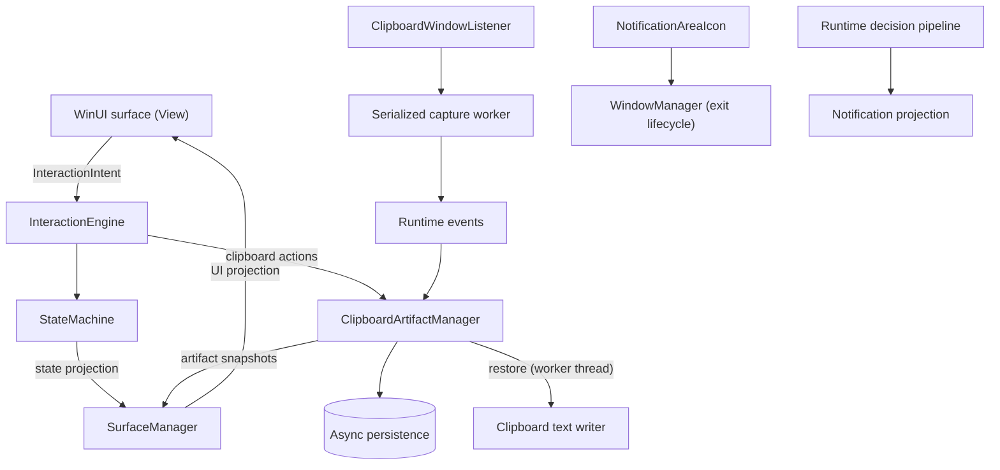

<div align="center">

# Aura

**A Dynamic Island–style floating surface for Windows that keeps your clipboard history within reach.**

[](https://dotnet.microsoft.com/)
[](https://learn.microsoft.com/windows/apps/winui/winui3/)
[](LICENSE)

[What it does](#what-it-does-today) · [Quick start](#quick-start) · [Limitations](#limitations) · [How it works](#how-it-works) · [Contributing](#contributing)

</div>

<!--
TODO: drop a GIF here showing the surface going compact -> expanded -> clipboard history.
Suggested path: assets/demo.gif
Syntax: 
This is the single biggest upgrade the page can get.
-->

Aura is a small floating surface that lives on your screen, in the spirit of Dynamic Island. It sits compact, expands when you need it, and gets out of the way when you don't. It's meant to be a quick place for useful actions and info, not another full app window, and it doesn't try to replace the apps where your real work happens.

Right now its main job is **clipboard history**: copy text like you normally do, and Aura keeps it so you can find it, pin it, and paste it back later.

> Early and under active development. Clipboard history works today. Notifications are built into the internals but don't have a real source hooked up yet (see [Limitations](#limitations)).

## What it does today

- **Floating surface.** A native WinUI 3 window with compact, expanded, interactive, dismissed, and recovery states, placed with awareness of your monitors.
- **Clipboard history (text).** Captures what you copy through the Windows clipboard listener and saves it between runs. You can filter it, pin and unpin items, delete them, and restore one back to the clipboard. Retention limits and duplicate merging keep the list from turning into a landfill.
- **No self-capture.** When you restore an item, Aura marks that write before it happens, so it doesn't save its own paste as a brand new copy.
- **Sensitive text filtering.** Best-effort detection with configurable handling. It's a heuristic, not a guarantee (more below).
- **Tray icon.** A notification-area icon with an **Exit Aura** action.

## Quick start

You'll need Windows 10/11, the .NET 9 SDK, and Visual Studio / MSBuild with the Windows App SDK and WinUI 3 build tooling. The app targets Windows 10 SDK build `22621`, so check the project files against your installed workloads if the build complains.

From the repo root:

```powershell
dotnet restore Aura.sln
dotnet build Aura.sln --configuration Debug
dotnet run --project src/app/Aura.App/Aura.App.csproj
```

You should see the floating surface appear, plus a tray icon whose menu has **Exit Aura**.

Don't run builds and tests at the same time. They can fight over the same MSBuild outputs.

### Build a standalone release

```powershell
powershell.exe -NoProfile -ExecutionPolicy Bypass -File scripts/publish-aura.ps1
```

This produces a self-contained `win-x64` Release in `dist/Aura/`, with the executable at `dist/Aura/Aura.App.exe`. `dist/` is generated output, so don't commit it.

## Limitations

Aura says what it can't do instead of pretending.

- **Clipboard is text only.** Images, files, and other formats aren't captured.
- **Sensitive-text detection is a heuristic.** It will miss things. Don't treat it as secret scanning or data-loss prevention.
- **No real notifications yet.** The pipeline exists (models, provider boundary, normalization, duplicate handling, priority and policy decisions, projection onto the surface), but the default provider reports itself as unavailable. A proper Windows notification provider is on the roadmap.
- **Not every state has been hand-checked on every setup.** Unit tests pass, but that doesn't prove every visual state and interaction looks right on every Windows configuration.

## How it works

Interactions go through explicit intents into a single state machine, and the UI only renders what that state says. The UI never owns state. Clipboard capture runs through a serialized, bounded worker, so a burst of copies can't spawn a pile of concurrent reads, and native clipboard and persistence work never blocks the UI thread.

Built with C# on .NET 9, WinUI 3 / Windows App SDK, and `Microsoft.Extensions.Hosting` with dependency injection. Tests use xUnit and FluentAssertions.

<details>
<summary><b>Architecture diagram and layers</b></summary>



| Layer | Responsibility |
|---|---|
| Application bootstrap | Builds the hosted app and composes runtime and UI services |
| Runtime | Event dispatch, policy and priority decisions, authoritative interaction state |
| Interaction | Maps UI intents to state transitions or artifact operations |
| Surface management | Projects runtime and artifact snapshots into the WinUI surface and handles window placement |
| Clipboard artifacts | History snapshot, retention rules, persistence, suppression, and artifact changes |
| Windows interop | Clipboard listening and reading/writing, plus the notification-area icon |

**Capture path:** clipboard event, listener callback, bounded worker, native clipboard read, runtime event, `ClipboardArtifactManager` snapshot, surface projection.

**Restore path:** the manager reserves suppression *before* the worker-thread clipboard write. The resulting sequence number is how Aura recognizes its own write and skips it.

Other rules the code follows: pin and delete failures roll back cleanly, subsystems talk through documented contracts instead of each other's internals, and state transitions are explicit.

</details>

<details>
<summary><b>Repository layout</b></summary>

```text
Dynamic-Island-Windows/
├── src/
│   ├── app/Aura.App/             # WinUI application and bootstrap
│   ├── runtime/Aura.Runtime/     # Runtime, decisions, state, artifacts
│   ├── ui/Aura.UI/               # Surface, interactions, windowing, interop
│   ├── shared/                   # Shared contracts and primitives
│   ├── infrastructure/           # Infrastructure and diagnostics projects
│   ├── features/                 # Feature project boundary
│   └── plugins/                  # Plugin project boundary
├── tests/
│   ├── unit/Aura.Tests.Unit/
│   ├── integration/Aura.Tests.Integration/
│   ├── performance/Aura.Tests.Performance/
│   └── accessibility/Aura.Tests.Accessibility/
├── assets/branding/              # Aura icon variants
├── scripts/                      # Build and publishing helpers
├── docs/                         # Project documentation and research
├── architecture/                 # Architecture material
├── specs/                        # Product and behavior specifications
├── Aura.sln
└── AGENTS.md                     # Repository-specific agent guidance
```

</details>

## Testing

```powershell
# everything
dotnet test tests/unit/Aura.Tests.Unit/Aura.Tests.Unit.csproj

# clipboard tests only
dotnet test tests/unit/Aura.Tests.Unit/Aura.Tests.Unit.csproj --filter FullyQualifiedName~Clipboard
```

These cover automated behavior only. To check a published build, launch `Aura.App.exe` and click through clipboard history on a real desktop: open, filter, scroll, pin, delete, restore, collapse, dismiss.

## Roadmap

- **A real notification provider**, including permissions, availability, and how notifications project onto the surface.
- **Hand-testing the clipboard flows** on the published executable, and tightening reliability around native writes, self-capture suppression, and persistence rollback.
- **Windows lifecycle checks**: startup, single-instance activation, window lifecycle, and tray icon cleanup.
- **An accessibility pass**: keyboard navigation, focus behavior, automation semantics, and high contrast.

## Contributing

Aura is spec-driven. Before building a feature, read the relevant docs in [`specs/`](specs), [`architecture/`](architecture), and [`docs/`](docs). [`AGENTS.md`](AGENTS.md) lays out which source of truth wins when they disagree. If the docs are missing or unclear, fix that first instead of inventing behavior.

Ground rules:

1. Keep changes focused and respect subsystem boundaries.
2. Add regression tests for behavior and failure paths.
3. Never block the UI on native I/O or persistence.
4. Keep clipboard contents and credentials out of logs and commits.
5. Keep keyboard access and semantic automation names intact.

Set up with the [Quick start](#quick-start), run the [tests](#testing), and open a PR.

## License

MIT. See [`LICENSE`](LICENSE).

---

Found a bug or a rough edge? [Open an issue.](../../issues)
