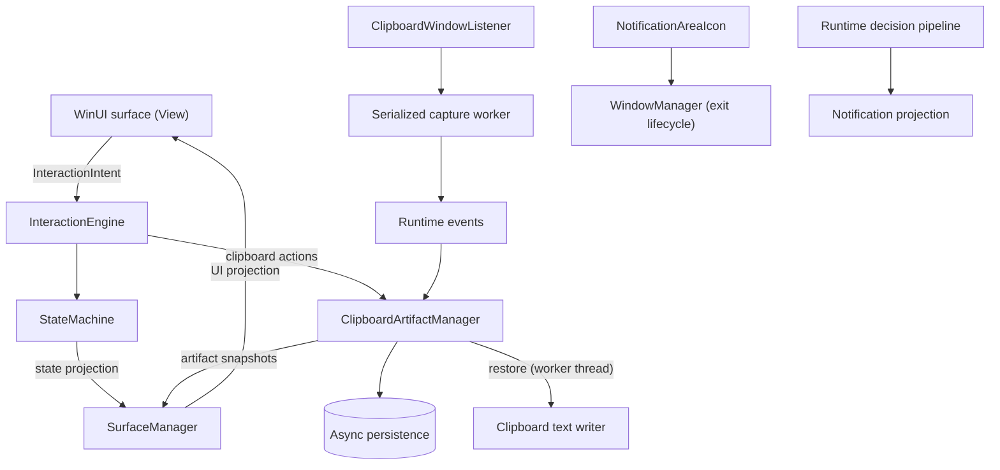

<div align="center">

# Aura for Windows

**A native, floating WinUI 3 surface for Windows that keeps clipboard history within reach and reduces context switching.**

[](https://www.microsoft.com/windows)
[](https://dotnet.microsoft.com/)
[](https://learn.microsoft.com/windows/apps/winui/winui3/)
[](LICENSE)

[Quick start](#quick-start) · [What works today](#what-works-today) · [Limitations](#limitations) · [Architecture](#architecture) · [Roadmap](#project-status-and-roadmap) · [Contributing](#contributing)

</div>

> [!NOTE]
> Aura is under active development. Today it includes a floating surface, persistent text clipboard history, a notification-area **Exit Aura** action, and notification-pipeline foundations. Notification ingestion uses an unavailable provider by default; a complete OS notification provider is still on the roadmap.

<!-- Add a short GIF or screenshot of the compact -> expanded surface and clipboard history here. Visual proof is the single biggest improvement this page can still get. -->

## Why Aura

Desktop work means constantly switching between applications and rebuilding context. Aura is a small, persistent surface for useful actions and information that does not try to replace the applications that own the work.

It is a Windows-native productivity layer that turns events, artifacts, context, and actions into timely interactions. The current codebase is an actively developed WinUI 3 desktop application and its runtime foundations, built around a few principles:

- **State is authoritative.** The UI reflects application state; presentation never creates or owns business state.
- **Native Windows behavior.** Windowing, clipboard capture, and notification-area integration use Windows APIs and WinUI.
- **Predictable interactions.** Explicit intents route through the interaction and state layers.
- **Recoverability and trust.** Clipboard history supports retention, sensitivity filtering, persistence, and sequence-based suppression for restored content.
- **Calm, accessible surfaces.** Design follows the project specifications and supports keyboard and assistive technology use.

## What works today

**Floating surface**
- WinUI 3 desktop surface with compact, expanded, interactive, dismissed, and recovery states
- Windows-native floating window setup with monitor-aware placement

**Clipboard history (text)**
- Capture through the Windows clipboard format listener, using serialized, bounded asynchronous work
- Persistent history with in-memory filtering, retention, and duplicate coalescing
- Pin/unpin, delete, and restore
- Restore protection: self-capture suppression is reserved *before* the clipboard write, and the native write runs off the UI interaction thread
- Best-effort sensitive-text classification with configurable handling (heuristic, not a guarantee that all sensitive data is detected)

**Notification foundations**
- Notification models, provider boundary, normalization, and duplicate identity handling
- Policy and priority evaluation, plus authorized surface projection

**Windows integration**
- Notification-area icon with an **Exit Aura** action

**Runtime and publishing**
- .NET hosting and dependency injection, runtime event dispatch, decision pipeline, and an authoritative state machine
- PowerShell helper for a self-contained Windows x64 Release publish

These are implemented foundations. They are not a claim that every workflow has been manually validated on every supported Windows configuration.

## Limitations

Aura is explicit about what it does not do yet. When platform access or data is unavailable, it should say so rather than invent successful behavior.

- It is not a replacement shell, task manager, notification center, or clipboard manager for the whole operating system.
- Clipboard history captures **text only**; it makes no claim about other clipboard formats or source applications.
- Sensitive-text detection is heuristic. Do not treat it as complete secret detection or data-loss prevention.
- Notification models and projection foundations do not establish that a production notification source is configured or available.
- Passing automated tests and a responsive process do not prove every visual state or interaction is correct. Manual desktop validation is recorded separately.
- No Media feature behavior should be inferred from the current architecture or repository layout.

## Quick start

### Prerequisites

- Windows 10/11 development environment
- .NET 9 SDK
- Visual Studio/MSBuild with the Windows App SDK and WinUI 3 build tooling required by the solution
- PowerShell (for the publish script)

The app targets Windows 10 SDK build `22621`. Check the project files and your installed Windows SDK and Visual Studio workloads for exact local requirements.

### Build and run

From the repository root:

```powershell
dotnet restore Aura.sln
dotnet build Aura.sln --configuration Debug
dotnet run --project src/app/Aura.App/Aura.App.csproj
```

Expected result: Aura starts a floating surface and adds a notification-area icon whose menu includes **Exit Aura**.

> [!TIP]
> For the repository's authoritative Debug MSBuild invocation, use the project's Windows toolchain and properties as your local environment requires. Avoid running builds and tests concurrently if they contend for the same MSBuild outputs.

### Publish a Windows x64 Release

```powershell
powershell.exe -NoProfile -ExecutionPolicy Bypass -File scripts/publish-aura.ps1
```

The script produces a self-contained `win-x64` Release in `dist/Aura/` and expects `dist/Aura/Aura.App.exe`. Treat `dist/` as generated output; do not commit it.

## Architecture

Interactions flow through intents into a single authoritative state machine, and the surface renders projections of that state.



### Layers

| Layer | Responsibility |
|---|---|
| Application bootstrap | Builds the hosted application and composes runtime and UI services |
| Runtime | Owns event dispatch, policy/priority decisions, and authoritative interaction state |
| Interaction | Maps deliberate UI intents to state transitions or artifact operations |
| Surface management | Projects runtime and artifact snapshots into the WinUI surface and applies window placement |
| Clipboard artifacts | Own the history snapshot, retention rules, persistence, suppression, and artifact mutations |
| Windows interop | Listens for clipboard updates, reads/writes native clipboard text, and integrates the notification-area icon |

### Clipboard paths

**Capture:** clipboard event → listener callback → bounded worker → native clipboard read → runtime event dispatch → `ClipboardArtifactManager` snapshot → `Changed` / surface projection → View.

**Restore:** a separate path. The manager reserves suppression *before* starting the worker-thread clipboard write, and the resulting sequence number keeps Aura from capturing its own write as a new user artifact.

### Design decisions

- **Bounded work.** Capture is serialized and coalesced instead of spawning unbounded concurrent clipboard reads.
- **Nonblocking UI.** Native clipboard and persistence work never synchronously blocks UI interaction paths.
- **Recoverable mutations.** Pin/delete persistence failures preserve rollback and error semantics.
- **Subsystem ownership.** Subsystems communicate through documented contracts, not each other's internals.
- **Deterministic state.** Transitions are explicit, and UI projections reflect authoritative state.

## Technology

| Area | Choice |
|---|---|
| Language / runtime | C# on .NET 9 |
| UI | WinUI 3 / Windows App SDK |
| Hosting | Microsoft.Extensions.Hosting and dependency injection |
| Platform APIs | Windows clipboard, window, and notification-area APIs |
| Tests | xUnit and FluentAssertions |
| Publishing | PowerShell, `win-x64` self-contained Release |

## Testing and validation

Run the unit suite:

```powershell
dotnet test tests/unit/Aura.Tests.Unit/Aura.Tests.Unit.csproj
```

Run only clipboard-focused tests:

```powershell
dotnet test tests/unit/Aura.Tests.Unit/Aura.Tests.Unit.csproj --filter FullyQualifiedName~Clipboard
```

Build and test results validate **automated behavior only**. To check a published executable, launch the EXE directly, verify the Aura process and top-level window handle, and exercise Clipboard History controls on the Windows desktop separately. Mark visual or manual results **UNVERIFIED** when desktop input is unavailable; do not infer them from unit tests or process liveness.

## Repository layout

```text
Dynamic-Island-Windows/
├── src/
│   ├── app/Aura.App/             # WinUI application and bootstrap
│   ├── runtime/Aura.Runtime/     # Runtime, decisions, state, artifacts
│   ├── ui/Aura.UI/               # Surface, interactions, windowing, interop
│   ├── shared/                   # Shared contracts and primitives
│   ├── infrastructure/           # Infrastructure and diagnostics projects
│   ├── features/                 # Feature project boundary
│   └── plugins/                  # Plugin project boundary
├── tests/
│   ├── unit/Aura.Tests.Unit/
│   ├── integration/Aura.Tests.Integration/
│   ├── performance/Aura.Tests.Performance/
│   └── accessibility/Aura.Tests.Accessibility/
├── assets/branding/              # Aura icon variants
├── scripts/                      # Build and publishing helpers
├── docs/                         # Project documentation and research
├── architecture/                 # Architecture material
├── specs/                        # Product and behavior specifications
├── Aura.sln
└── AGENTS.md                     # Repository-specific agent guidance
```

## Project status and roadmap

Aura is under active development and its capabilities are foundations, not a finished product. See [Limitations](#limitations) for what is not claimed.

| Workstream | Current direction |
|---|---|
| Clipboard responsiveness and reliability | Preserve nonblocking native writes, deterministic suppression, transactional persistence rollback, and responsive UI interactions |
| Clipboard interaction validation | Exercise open, filter, scroll, pin/unpin, delete, restore, collapse, and dismiss on the published executable |
| Windows lifecycle | Validate startup, single-instance activation, window lifecycle, and notification-area cleanup |
| Notification integration | Complete a supported provider path and validate permissions, availability, and projection behavior |
| Accessibility | Validate keyboard navigation, focus behavior, automation semantics, and high-contrast/native accessibility behavior |
| Documentation | Keep implementation and public claims aligned with current specifications and tested capabilities |

## Contributing

Aura is specification-driven. Before implementing a feature, read the applicable product, behavior, architecture, API, design-system, MVP, and engineering documents. [`AGENTS.md`](AGENTS.md) defines the source-of-truth order and requires implementation to trace back to documented product behavior. If documentation is missing or ambiguous, resolve that gap before inventing a new product contract.

Set up with the [Quick start](#quick-start), run tests with [Testing and validation](#testing-and-validation), then:

1. Keep each change focused and respect subsystem ownership.
2. Add regression tests for behavior and failure paths.
3. Do not make synchronous native I/O or persistence block UI interactions.
4. Keep sensitive clipboard content and credentials out of logs and commits.
5. Do not infer visual correctness from compilation, tests, or process health.
6. Do not work around missing platform capabilities by inventing product behavior.

Preserve keyboard access, semantic automation names, clear component responsibilities, and testable boundaries.

## License

MIT. See [`LICENSE`](LICENSE).

---

<div align="center">

**Aura: timely Windows interactions, grounded in predictable state.**

Found a bug or a rough edge? Open an issue.

</div>
